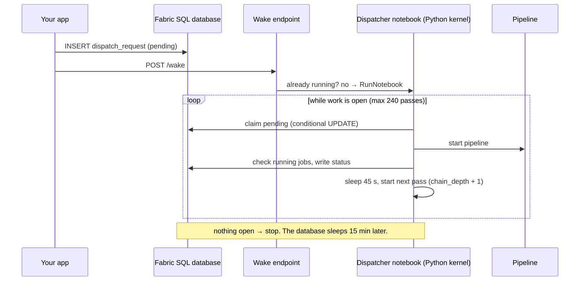

# fabric-event-dispatcher

An event-driven, self-chaining dispatcher for Microsoft Fabric apps that queue work in a Fabric SQL database. The goal is simple: let the database go to sleep when nobody is using the app.

A Fabric SQL database bills while it is online and only releases compute after about 15 idle minutes. A dispatcher notebook on an every-minute schedule never gives it those 15 minutes. Neither does a browser tab that polls every 15 seconds. In the production app this pattern came from, replacing the every-minute schedule with this design took the app's items from **204 to 6.7 CU-hours a day (−96.7%)**, and the database alone from 136 to 1.2.

Write-up: _[link to the blog post]_

## How it works



1. **The app wakes the dispatcher.** After writing a request row, the app calls a small wake endpoint. It checks whether the dispatcher notebook already has a `NotStarted` or `InProgress` job instance and, if not, starts one through the Fabric job scheduler API. Workspace and notebook IDs are fixed at deploy time. The wake never throws, so a failed wake never fails the user's save.
2. **The dispatcher keeps itself going while there is work.** Each pass ends by asking whether anything is still open: pending, claimed or running requests from the last 24 hours, or a setting whose desired value hasn't been applied yet. If so, it sleeps and starts the next run of itself before the current one ends, passing every parameter forward. The chain is capped at 240 passes.
3. **Overlapping passes are safe.** Each request is claimed with `UPDATE ... SET status = 'claimed' WHERE id = ? AND status = 'pending'`. If no row changed, another pass has it.
4. **A daily safety run** replaces the every-minute schedule and picks up anything a missed wake left behind.

The client side matters as much: pause your app's auto-refresh while its tab is hidden or idle, or one open tab will keep the database awake on its own.

## What's here

| Path | What it is |
|---|---|
| `src/fabric_dispatcher/` | The library: job scheduler client, wake, request store, one dispatcher pass, chaining |
| `notebooks/dispatcher_notebook.py` | Fabric notebook source (Python kernel) that runs one pass and chains |
| `wake_function/` | Wake endpoint as an Azure Function using its managed identity |
| `sql/schema.sql` | Request and settings tables (T-SQL) |
| `tests/` | Unit tests against SQLite and a fake job API |

## Setup

1. Create the tables in your Fabric SQL database with `sql/schema.sql`.
2. Import `notebooks/dispatcher_notebook.py` as a notebook on the **Python** kernel. Mark the first cell as the parameter cell, fill in `sql_server`, `sql_database` and the pipeline IDs in `ROUTES`.
3. Deploy `wake_function/` with app settings `DISPATCHER_WORKSPACE_ID` and `DISPATCHER_NOTEBOOK_ID`, and give its managed identity Contributor on the workspace.
4. Make your app call `POST /api/wake` after every write to `dispatch_request`.
5. Replace any frequent schedule on the notebook with one daily run. After every notebook import, list its schedules and keep exactly one.

## Status

v0.1. The library is unit-tested; the notebook and wake function are reference glue to adapt. Check the ODBC driver name and token audiences against your Fabric runtime. Issues and PRs welcome.

## Development

```bash
pip install -e ".[dev]"
pytest
ruff check . && ruff format --check .
```

## License

MIT
